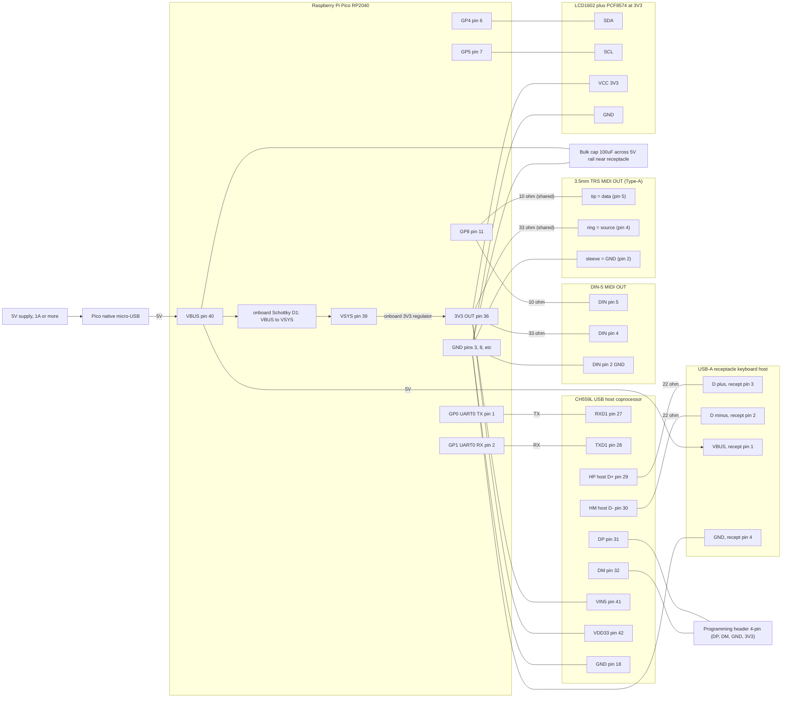

# KeybChord (Pico Edition) — Wiring Diagram

Visual companion to the canonical pin map. The pin/power tables in
**Spec §2.2** ([KeybChord_Pico_Spec.md](KeybChord_Pico_Spec.md)) remain
**authoritative** for exact pins and component values; this diagram is a rendered
connection view of those tables.

This is a **logical connection diagram** (which wire goes where), not a physical
breadboard layout. All resistors are **1/4 W (0.25 W)**.

## Combined wiring diagram

A pre-rendered image is below (use this if your Markdown viewer does not render Mermaid).
The Mermaid source follows it and is the editable source of truth; regenerate the PNG
after editing (see "Regenerating the PNG").


<details>
<summary>Mermaid source (editable)</summary>



</details>

## Legend & notes

- **All resistors 1/4 W (0.25 W)** — actual dissipation is only milliwatts.
- **USB host (CH559L coprocessor on UART0):** the keyboard is hosted by a dedicated
  **CH559L** (WCH 8051 MCU with a hardware USB host controller). It enumerates the
  keyboard (hubs + report/NKRO), parses HID reports, and forwards key events to the Pico
  over **UART0** — `GP0`=TX (→ CH559 `RXD1` pin 27), `GP1`=RX (← CH559 `TXD1` pin 28).
  The CH559 **HP** (pin 29) / **HM** (pin 30) run to the receptacle through **22 Ω** series
  resistors (the only series elements; the keyboard supplies device-side pull-ups). `DP`
  (pin 31) / `DM` (pin 32) go to a **4-pin programming header** for flashing the CH559 via
  its USB bootloader. **Power:** `VIN5` (pin 41) and `VDD33` (pin 42) both to `3V3(OUT)`
  (0.1 µF decoupling; at a <3.6 V supply the internal LDO is bypassed), `GND` (pin 18) to
  ground. Runs off its **internal oscillator** (no crystal). `RST` is pin 3.
- **DIN MIDI OUT (3.3V loop):** driven directly from the 3.3V `GP8` TX pin —
  **10 ohm** in series with `GP8` to DIN pin 5, **33 ohm** from `3V3(OUT)` to DIN pin 4,
  GND to DIN pin 2. Standards-compliant per the MIDI 1.0 Electrical Spec update (2014).
  In firmware, call `Serial2.setTX(8)` before `Serial2.begin(31250)`. The RP2040 UART TX
  is push-pull (not open-drain) — a benign deviation that works with standard
  opto-isolated inputs; optional ferrite beads on the DIN signal pins reduce RFI.
- **TRS MIDI OUT (3.5mm, Type-A):** wired **in parallel** with the DIN loop and
  shares the same 10 ohm / 33 ohm resistors (not duplicated). Type-A: **tip** =
  DIN pin 5 (data, `GP8`), **ring** = DIN pin 4 (source, `3V3`), **sleeve** =
  DIN pin 2 (GND). Both jacks drive a downstream synth simultaneously.
- **LCD1602/PCF8574:** I2C0 on `GP4` (SDA) / `GP5` (SCL); **powered at 3.3V** so the I2C
  bus stays 3.3V-safe. Pull-ups from the backpack or 4.7 kohm to 3.3V. Firmware
  auto-probes address `0x27` then `0x3F`, falling back to the null LCD adapter if absent.
- **Power (canonical):** native micro-USB -> `VBUS` powers the Pico; the keyboard draws
  5V from `VBUS` (upstream of onboard Schottky **D1**, so keyboard current bypasses D1).
  Use a **>=1 A** supply sized for the cable/connector combined current, and a **100 uF**
  bulk cap on the 5V rail near the receptacle (hot-plug inrush / brownout protection).
- **Back-feed rule:** do **not** inject a regulated 5V into `VSYS` while also powered from
  native USB unless that external `VSYS` feed has **its own series Schottky diode**. Pick
  one power path. (The onboard D1 only covers `VBUS`->`VSYS`.)
- **Master power switch (recommended, not required):** the Pico's micro-USB is soldered
  directly to `VBUS`, so there is no on-board break point. A switch that cuts the Pico *and*
  the keyboard lives **off-board** — an inline USB power switch or a switched PSU (not drawn).
- **3V3(OUT) budget:** the LCD runs off `3V3(OUT)` (~300 mA rail shared with the RP2040);
  keep a backlit LCD within budget or power its backlight separately.

For reference designs and precedent (rppicomidi, Adafruit MIDI FeatherWing, PJRC/Teensy,
MIDI.org 2014 update, CH559 datasheet / HIDman / atc1441 CH559sdccUSBHost, Pico datasheet
power section), see the spec.

## Flashing the CH559

The CH559 is programmed over **USB** (its `DP`/`DM` device port), not UART. Only **D+,
D-, GND** are needed from the PC — the board self-powers at 3.3 V, so do **not** connect
the PC's 5 V `VBUS` into the board.

**Board-side connector (recommended):** a **4-pin 0.1" (2.54 mm) male header** — `DP`
(pin 31), `DM` (pin 32), `GND`, and `3V3` (the 4th pin is optional, used only as a power
reference). Through-hole and trivial to hand-solder. The header's `GND`/`3V3` are the
Pico's ground and `3V3(OUT)` (the same rail that powers the CH559); the `3V3` pin is a
reference only — do not feed power into it and never connect the PC's 5 V `VBUS`.

**Cable/programmer:** a **USB-A male plug breakout** (a small board with a USB-A plug and
labelled `VBUS`/`D+`/`D-`/`GND` pads). Solder a 4-pin female dupont/JST-XH pigtail to it —
`D+`→DP, `D-`→DM, `GND`→GND, and leave `VBUS` unconnected — then plug the USB-A straight
into the PC. Avoid a raw USB-A↔A cable (host-to-host hazard); a labelled breakout or a cut
cable is the safe route.

**Bootloader entry (first flash):** CH55x enters its USB bootloader by pulling **D+ (DP)
high through ~10 kΩ** during reset. So also place two tactile buttons (or two shortable
pads) on the board: **BOOT** (10 kΩ `DP`→3V3) and **RESET** (pin 3). After the first
flash, `ch55xtool`/ch55xduino re-enters the bootloader over USB automatically, so the
buttons/pads are mainly for initial programming.

**Software:**
- [`ch55xtool`](https://github.com/MarsTechHAN/ch552tool) — Python, cross-platform:
  `python3 ch55xtool.py -f firmware.bin`.
- [`WCHISPTool`](https://www.wch.cn/downloads/WCHISPTool_Setup_exe.html) — WCH's Windows tool.
- Firmware base: [`atc1441/CH559sdccUSBHost`](https://github.com/atc1441/CH559sdccUSBHost)
  (SDCC) or WCH's `CH559EVT` host examples.

**Parts / sources:**
- **USB-A plug breakout** (the PC-side plug with labelled pads):
  [Adafruit 4448 — USB Type A Plug Breakout Cable w/ female jumpers](https://www.adafruit.com/product/4448)
  (ready-made pigtail, recommended) or
  [Adafruit 1387 — USB DIY Connector Shell (Type A Male Plug)](https://www.adafruit.com/product/1387)
  (bare shell; solder your own wires). Generic "USB A plug breakout" modules are also
  available from AliExpress/Amazon.
- **Board header + pigtail:** a 1×4 **0.1" (2.54 mm) male pin header** — e.g.
  [Adafruit 392 — Break-away 0.1" 36-pin strip male header](https://www.adafruit.com/product/392)
  (snap off 4 pins) — plus female dupont jumpers to mate with it, e.g.
  [Adafruit 1951 — Premium Female/Female Jumper Wires, 20×3"](https://www.adafruit.com/product/1951)
  or [Adafruit 266 — 40×6"](https://www.adafruit.com/product/266). (JST-XH pigtails are an
  alternative from Digi-Key/LCSC.)
- **Tactile switches:** 2× 6×6 mm tactile pushbutton (BOOT/RESET) — e.g.
  [Adafruit 367 — Tactile Switch Buttons](https://www.adafruit.com/product/367) or any
  Digi-Key/LCSC equivalent.
- **Passives (board):** 1× 10 kΩ resistor (BOOT pull-up) and 2× 0.1 µF capacitors
  (`VIN5`/`VDD33` decoupling) — generic parts.

**Procedure:** hold **BOOT**, tap **RESET**, release **BOOT** → the CH559 enumerates as a
USB bootloader device on the PC → run `ch55xtool -f <firmware>.bin` → done.

## Regenerating the PNG

`wiring.png` is rendered from the Mermaid source above using the Mermaid CLI:

```bash
# Extract the mermaid block to wiring.mmd, then:
npx @mermaid-js/mermaid-cli -i wiring.mmd -o wiring.png -b white -s 2
```

On a headless Linux box you may need a Chromium/`chrome-headless-shell` for Puppeteer
and a puppeteer config passing `--no-sandbox`. If Mermaid renders in your Markdown
viewer, editing the source block and re-exporting is all that's needed to refresh the PNG.

Headless alternative without node/docker: POST the Mermaid text to
`https://kroki.io/mermaid/png`, or use mermaid.ink by encoding
`{"code":"<mermaid>","mermaid":"{\"theme\":\"default\"}"}` with zlib + base64url and
fetching `https://mermaid.ink/img/pako:<b64>?type=png&bgColor=FFFFFF`.

